# Ultima: Frost and Ember

Welcome to Frost and Ember, an Ultima Online shard, a fork of Ultima: Memento by Tsai. You'll find the classic sprawling world you know, along with a new story to uncover, a lot of quality-of-life improvements and a reworked balance across crafting, combat and character progression. This guide covers what's different here and how to get started.

Come and say hello on our Discord: https://discord.gg/8rrFctabY

## Downloads

Download the latest version from the [Releases page](https://github.com/PopNotSoda2112/Frost-and-Ember/releases/latest).

- **Windows client** (`.zip`) and **Linux client** (`.tar.gz`): the TazUO launcher and client, with the shard's maps, artwork and music, ready to play.
- **Server** for **Windows** (`.zip`) and **Linux** (`.tar.gz`): a fresh world, ready to host. See [Hosting your own server](#hosting-your-own-server) below.

---

## The story: Frost and Ember

The village of Lornmere on the Serpent Island was frozen solid in a single night, people and all. The Crown's inquiry laid the blame on a company of adventurers from Sosaria, who were said to have disturbed unstable artefacts in some nearby ruins. In response, Lord British founded the Royal Expeditionary Society, which was charged with making sure that nothing like it could ever happen again. Its explorers and scholars survey ancient ruins, study what they recover and keep dangerous discoveries out of careless hands, all under the motto "Through knowledge, a safer tomorrow." Six years later, a new threat has emerged that could undo everything the Society was founded to protect.

This is a long, original quest line that runs through Britain, Lornmere, and other new areas. It starts on the roads near Britain and your quest journal (`[quests`) keeps track of every lead.

- **Two routes.** An honest adventurer serves the Crown. A **wanted character**, such as a fugitive, murderer or other outlaw, is drawn instead into the service of a fixer at the Fort of Stonewall, and sees the same story from the other side. The routes share the ending but not the journey.
- **Rewards.** These include a unique title on each route and a permanent boost to your secondary skill pool. The final foe also contains other goodies that players should find rewarding.
- **Once you've finished,** you can walk the road again from the start.
- **Original music.** A new dungeon on the questline has three pieces of music written entirely by Pop_NotSoda. You can also play them any time from the `[music` playlist, as "Frost and Ember - Ascension", "Frost and Ember - Confrontation" and "Frost and Ember - Transfiguration".
---

## Installing and playing

1. Download the client for your system from the shard's Releases page: **Windows** (`.zip`) or **Linux** (`.tar.gz`). Unpack it wherever you like and keep the folder together.
2. Open **TazUOLauncher.exe** on Windows, or **TazUOLauncher** on Linux.
3. Select **Ultima: Frost and Ember**, let any TazUO updates finish, and click **Play**.
4. At the login screen, type the username and password you want. If the account doesn't exist yet, the server creates it for you, so remember what you typed.

The launcher keeps the TazUO client up to date by itself, so leave the `TazUO` folder to it and don't put your own files there. The shard's own maps, artwork and music are in the `Shared/GameData` folder, and the shard posts a new download when those change. If the launcher won't open, `Start-Client-Direct-Windows.cmd` or `Start-Client-Direct-Linux.sh` starts the game directly, without checking for updates.

Two settings start out differently from a plain TazUO install. Click-to-walk pathfinding is off, and you can turn it on in TazUO's options if you like it. You talk to NPCs by double-clicking them, which you can switch off under **Double Click Talk** in `[help` → Preferences.

---

## Getting started

**Your first steps.** Every new character begins in the Gypsy Forest, where the gypsy helps you choose where your story starts. When you enter the world for the first time, you'll find an **outfitter's token** in your backpack. Double-click it to open the Outfitter, where you choose a starting kit and a few extras. If you close the window, double-clicking the token opens it again, and the token is used up when you confirm.

- **Kits:** Knight, Samurai, Ninja, Ranger, Rogue, Bard, Tamer, Artisan, Mage, Elementalist and Dark Arts. Each kit gives you the gear for its trade.
- **Extras:** you get **four picks** on top of your kit, such as additional gear, reagents and bandages. Weapon picks include a one-handed and a two-handed choice for each weapon skill.
- **Every character also starts with** some gold, a knife, food and water, scissors, a candle, a blank book to write in, and a **Traveller's Primer**.

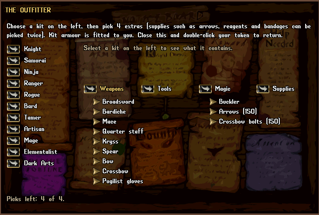

**The Traveller's Primer** lets you choose two different secondary skills below 50 and raises both to 50. It's bound to your character and is used up when you confirm.

**Skills.** Press your Skills button or type `[skillbook` to open the **skills journal**, a two-page window with main skills on one side and secondary skills on the other. Each side has a running total. You can fold away skill groups, hide skills at 0, click the arrows to raise, lower or lock a skill, and click the gem beside a skill to use it. The classic skills window is still a click away. If its skill groups ever look wrong, click **Reset groups** in it; that resets the grouping only, not your skill values.

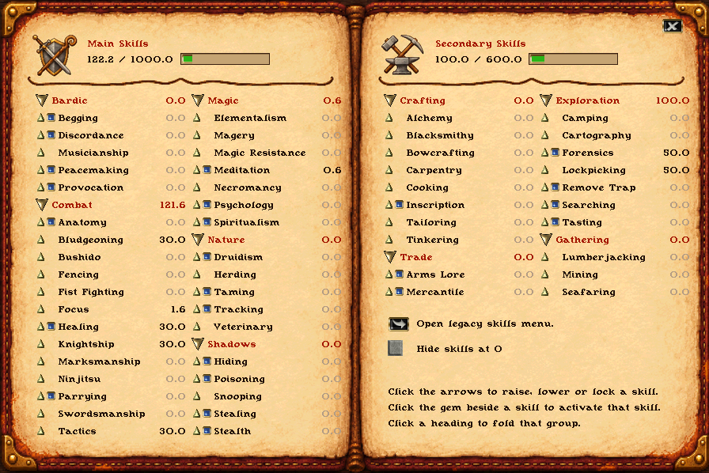

**The help window.** Type `[help` for the help window. It covers commands, settings, preferences and your treasury.

---

## Skills and character

- **Two skill pools.** Main skills share the usual total skill cap. Secondary skills, such as crafting, gathering, Arms Lore, Camping, Cartography, Lockpicking, Mercantile, Remove Trap, Seafaring, Searching and Tasting, share their own pool of **600 points**. That pool can grow to **700**:
  - +50 for completing the Frost and Ember story;
  - +25 the first time three secondary skills reach 100;
  - +25 for reading a rare **Tome of Forgotten Trades**, found on champion bosses and in level 5 or higher treasure chests.
- **Stat gains** have no waiting time between gains, but are more difficult to gain.
- **NPCs can teach** secondary skills as well as main skills.
- **Stealing, Snooping and Begging** are main skills, so they count toward your total skill cap.
- **Humans** get a larger combined stat allowance as they level (up to +25), 250 Luck, and a 5-point higher maximum in every resistance. Every other race already had bonuses of its own, and Humans were the only one without any, so these give them their own reason to be chosen.

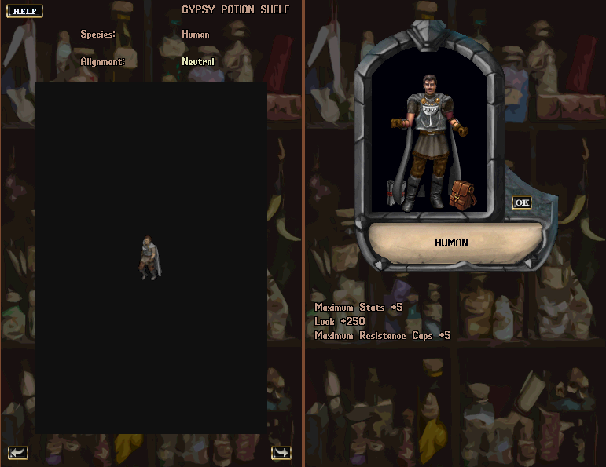

---

## Combat and defence

**Resistances** cap at **70%** in each type, or 75% for Humans. Lower Reagent Cost can reach 100%.

**Armour** is the main source of your resistances, and crafted armour is the best of it.
- A plain starter suit gives roughly **12 physical** in leather, **17** in studded, **21** in ringmail and **30** in plate. Every armour piece also adds a little to each elemental resistance.
- Better metals and leathers, and exceptional craftsmanship, raise this considerably. A top-quality exceptional suit reaches well into the 50s and 60s, leaving room for jewellery, clothing and spells to finish the job.
- **Ordinary clothing** gives +1 to each elemental resistance per piece, but no physical. Clothing never wears out.

**Magic Resistance** no longer raises your resistances. Instead, it protects you from harmful effects:
- At 100 skill, you have a **30% chance to shrug off** a curse, paralysis, freeze, web, sleep, fear, confusion, mana drain or poison entirely. The chance is 0.3% per point.
- At 100 skill, any effect that does land on you lasts **up to half as long**, 0.5% shorter per point.
- At 100 skill or more, **poison hits you one level weaker**, which makes you immune to Lesser poison.

**Weapons, armour and shields** wear as they did in Memento.
- **Repairs wear gear down,** so it pays to learn a craft or find a crafter. Every repair fills an item to its maximum, but may lower that maximum:

| Who repairs | Maximum durability lost |
|---|---|
| A merchant | 1 for every 10 points mended. A **light repair** (under 10 points) has a 1 in 5 chance of costing 1. |
| A player, or a repair contract | A **(100 − skill)%** chance of losing 1: 50% at 50 skill, 20% at 80, **none at 100**. |
| A repair potion | Always 1. |

  For example, a merchant takes a 0/50 sword to 45/45, while a crafter with 100 skill takes it to 50/50. Crafting skills come from the secondary skill pool, so any character can learn to mend their own gear.
- **Crafters:** choose **Repair** in your crafting menu, and a window lists everything you wear or carry that your craft can mend, with your chance of losing maximum. Repairs never fail. To make a repair contract or pick one item, choose **Choose an item yourself**.
- **Repairing for other players:** choose **Repair another player's gear** in that window, or target a player with **Repair**, and name your price per point of durability (0 for a friend). They see a list of their own damaged gear that your craft can mend, with each item's price and your chance of costing maximum durability, and untick anything they want to leave. When they accept, you repair it where it is, so nobody hands anything over. They pay from their backpack and then their bank, and the gold goes to your bank. Stay within 3 paces until they answer, and keep your tool on you (and a forge and anvil nearby for smithing). An offer lasts 5 minutes.

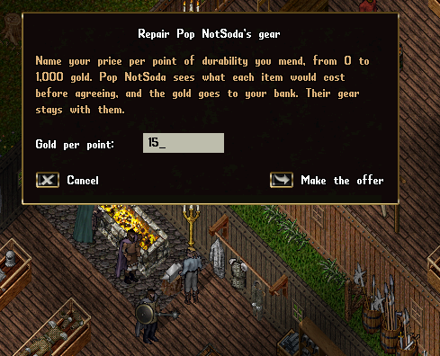

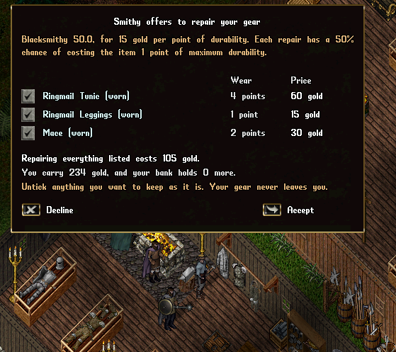

- Smiths, tailors and leatherworkers charge by what the item is, per point of durability:

| Item | Gold per point |
|---|---:|
| Plain (bought, or crafted at normal quality, any metal or leather) | 3 |
| Exceptional | 10 |
| Magic (from loot, a runic tool or enchanting) | 20 |
| Artifact | 30 |

  Plain gear is cheap to keep up. Valuable gear is where a crafter saves you the most, in gold and in maximum durability.
- Any tailor, weaver, cobbler, tanner, fur trader or leather worker mends anything a tailor could, so cloth, leather and hide all go to the same shop.
- Choose **Repair** on a merchant, and a window lists everything you wear or carry that they can mend, with the price of each and the maximum durability it will cost. Untick anything you want to leave, and the merchant will also tell you who can mend the rest. To pick one item instead, choose **Choose an item yourself**.
- Repairs are paid from your backpack first, and then from your bank.

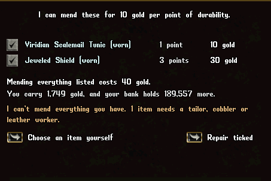

**Bard songs.** The ten buff songs cost no mana, cast in one second and last an hour. They are:
- Fire, Ice, Poison and Energy Carol, each giving +8 to its resistance;
- Knight's Minne, +8 physical;
- Sinewy Etude, Shepherd's Dance and Enchanting Etude, +10 Strength, Dexterity and Intelligence respectively.

**Instruments never wear out,** and songs use whichever instrument you're holding or carrying without asking you to pick one. Discordance, Provocation and Peacemaking are easier to land on tough creatures, and Provocation and Discordance recover in five seconds.

---

## Crafting and gathering

- **Every recipe is available from the start.** You don't need to unlock anything with scrolls or quests; skill and materials are all you need.
- **Tools** start with 150 uses and wear out as you use them. Tools, fishing poles, pickaxes and the like work straight from your backpack, so you don't need to equip them.
- **Resource nodes are larger**, gathering yields more, and you can mine while mounted.
- **Merchants don't sell crafting materials in bulk,** such as ingots, boards, leather and cloth, and the few resources they do sell cost six times the usual price. Gathering your own is the way to stock up.
- **Shoppe orders** pay well, at roughly 3,200 gold or 1,500 points per order at 100 skill, and bigger at higher skill. New orders arrive every hour, up to 3 at a time.

---

## Food and cooking

- **There's no hunger or thirst.** You never need to eat or drink, so there's nothing to keep topped up. A server's owner can turn hunger and thirst back on.
- **Ordinary food is a snack.** Bread, fruit, cooked meat and the rest heal you up to your Tasting skill and restore 10 stamina, and with enough Tasting they may cure poison. You can have one snack every 30 seconds. Blood does the same for vampyres, and brains for zombis and the other brain eaters.
- **Dishes that only player cooks can make** leave you **well fed**: you regain health, stamina and mana faster, and learn every skill a little faster. Merchants never sell them, and they never drop as loot.

| Kind | Cooking skill | Health / stamina / mana regeneration | Skill gain |
|---|---|---|---|
| Hearty meal | 40 – 90 | +1 / +2 / +0 | +5% |
| Fine dish | 60 – 110 | +1 / +2 / +1 | +10% |
| Feast dish | 80 – 120 | +2 / +3 / +1 | +15% |

- **Exceptional dishes** work like exceptional weapons and armour: each time you cook there's a chance of one, and it grows with your skill. A normal dish lasts 30 minutes; an exceptional one lasts 60 and doubles the regeneration. A grandmaster cook makes hearty meals exceptional three times in four, fine dishes about a third of the time, and feasts only once in 20. Power scrolls raise those chances.
- **Tasting** makes the bonus last up to half as long again.
- **One meal counts at a time.** A better dish replaces the one you're on, and a lesser one only tops up the time. The bonus survives death and logging out, and only counts down while you're playing. `[myhunger` shows how long you have left.
- **The regeneration goes on top of your gear's cap,** so even a well-equipped character gains from eating.
- **The dishes:**
  - **Ordinary races:** hunter's stew, fisherman's chowder and apple-glazed ham (hearty); shepherd's pie, stuffed roast fowl and orchard tart (fine); royal roast pig, seafarer's platter and herb-crusted lamb roast (feast).
  - **Vampyres:** Bloody Mary-nated Ribs, Bat Wing Buffalo Wings, and Blood Orange Soup, Hold the Orange.
  - **Zombis, ghouls, wights and mind flayers:** Head Cheese, Food for Thought Pie and Grey Matter Gumbo.
  - **Ents, reapers, fungals, shamblers and swamp things,** who drink theirs: Compost Tea, Root Beer (Actual Roots) and Photosynthesis Smoothie.
  - **Skeletons, mummies, revenants and shadow demons,** who rub theirs on: Bone Appetit, Rattle-Free Joint Oil and Spa Day at the Crypt.
  - The Cooking menu lists each one with its ingredients. Any cook can make any of them, so an ordinary cook can sell Head Cheese to zombi players.
- **Human remains:** a heart or severed head carved from an innocent person is marked "Taken from an innocent". Cooking with one is a crime, just as carving it was: you lose karma, and the guards come for you. Outlaws' remains are fair game.
- **Cooking helps with alchemy too:** your own Cooking and Tasting make the elixirs you drink last longer and grant more, and the mixtures you throw last longer and hit harder, with a chance of a second slime.

---

## Loot, gold and selling

- **Loot drops as gold.** Copper, silver, gems and nuggets you already own convert to gold automatically. The Underworld's jewels and the crystals of the Mines of Morinia are still local currencies.
- Merchants identify things for **200 gold each**, paid from your backpack first and then your bank. Choose **Identify**, and a window lists everything in your backpack that they can appraise. Untick anything you want to leave, and they'll also tell you who can do the rest.
- Merchants appraise by family, so you rarely need more than two stops. Smiths, tailors, leather and wood workers, jewellers, bards, provisioners and merchants handle all weapons, armour, clothing and jewellery. Mages, alchemists, herbalists, enchanters, sages and scribes handle potions, reagents, scrolls, wands and artefacts. Bankers, minters, provisioners and merchants value coins and trade goods, and sages, scribes and librarians decipher coded parchments.
- **Every vendor will buy almost anything,** but they only pay a fair price for goods in their own trade. Anything else fetches a token amount, plus whatever its magic properties are worth. Guildmasters pay the full price for everything, so they're the best place to sell. Selling 100 gold or more to any vendor or guildmaster can train Mercantile, and so can buying.

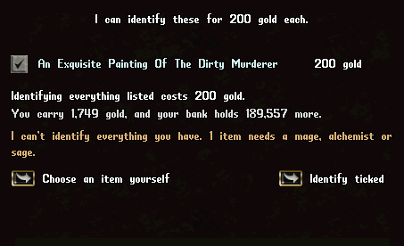

- **Trading gold:** to trade with another player, click them and choose **Trade**, type `[Trade` and target them, or drop an item on them. A gold window opens beside the trade window. It shows your own gold, in your backpack and your bank. Type what you want to give and press **Set**, and a check for that amount appears on your side of the trade, so you both see it. Your gold stays where it is until the trade completes, and if the trade is cancelled the check simply disappears. Setting an amount clears both checkmarks, so check the trade again before accepting. When you both accept, the gold comes from your backpack first and then your bank, and goes into the other player's bank.

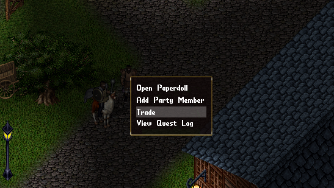

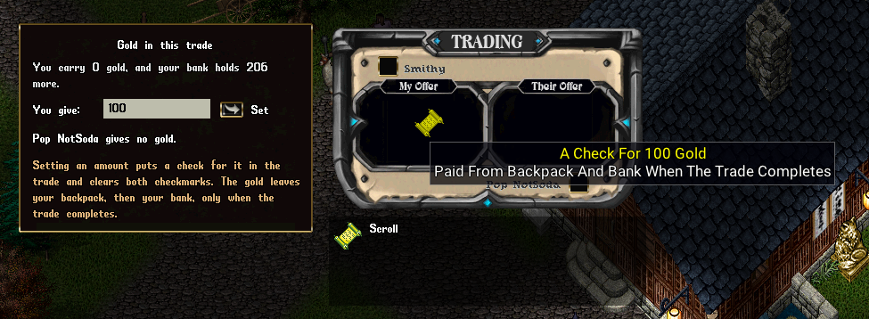

- **The marketplace:** double-click a Merchant Advertiser board, or type `[Market`, to open the marketplace. It shows every item for sale on every player-run vendor in the world, all in one window, so you can shop without visiting each vendor. The one exception: Avatar characters see only other Avatar characters' shops, and permadeath characters see only other permadeath characters' shops. It works in towns and inns, in your own house, and beside a Merchant Advertiser board. Search by name, pick a kind of item, and sort by price or by what's newest. Hover over an item to see its details, and click it for the price, the shop and where it stands. You can buy straight from the window: the gold comes from your backpack and then your bank, and the item goes to your backpack, or to your bank if your backpack is full. You can buy part of a stack of resources, reagents, bandages or arrows, such as 100 of a vendor's 500 ingots, and you pay that share of the stack's price. Other stacks, such as food, are sold whole. To sell, stock and price items on your own vendor as usual, and they appear in the marketplace for everyone. You're told when something sells while you're online.

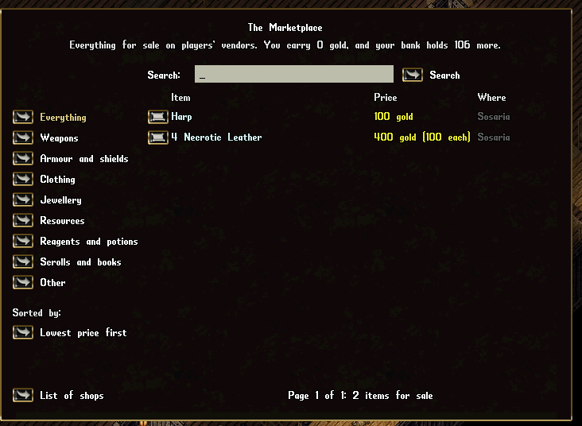

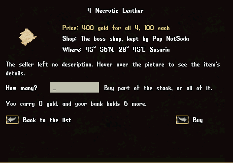

---

## Inventory and banking

**Items have no weight.** Instead, your **backpack holds a number of items**, starting at 50. Mara the outfitter, on the open floor of the public bank, offers permanent upgrades up to **150 items**. Type `[BackpackProgress` to see what you need next or speak with Mara.

| Backpack | What it takes |
|---|---|
| 75 items | An errand for Mara: 1,000 gold and 100 leather. |
| 100 items | **Five skills at 80**, plus a reinforced backpack lining. You can tailor the lining or buy it from Mara. |
| 125 items | **Five skills at 100**, plus 3 Society job board jobs or 15 shoppe deliveries. |
| 150 items | **Three skills at 110**, plus 10 dungeons discovered or 50 shoppe deliveries. |

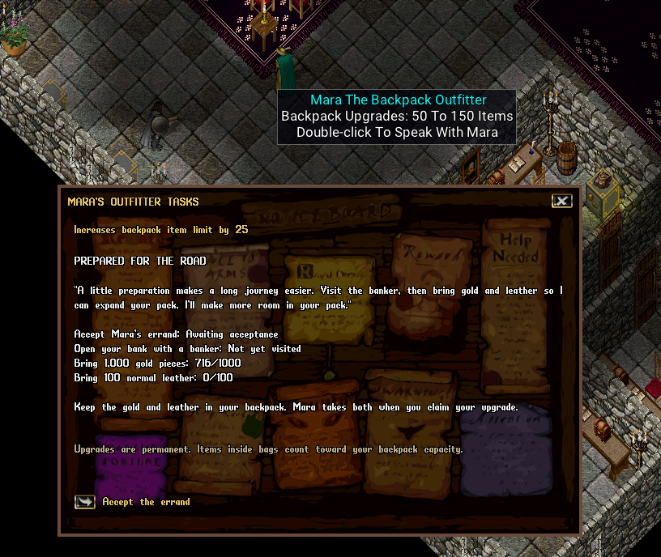

**One bank for your whole account.**
- Your bank gold is kept in an account ledger that all your characters share.
- Your **bank items are shared too.** Whichever of your characters opens the bank sees everything your account has stored. The exception is items bound to one character, such as quest items, which stay with that character.
- Bank vaults now hold 1000 items with no weight limits.

**Housing.** Each account can own as many houses as it likes.

**Treasuries** let several accounts share one bank, gold and items alike, which suits friends or a guild pooling their wealth.
- **Whole accounts:** a treasury belongs to accounts, not single characters. When you create or join one, every character on your account shares it, so you can't put just one of your characters in and keep the rest out.
- **Creating and inviting:** create one from the **Treasury** section of `[help`, then invite people by clicking one of their characters.
- **Joining:** joining adds all your bank gold and items to the treasury.
- **Leaving:** you take nothing with you, so only join a treasury you trust.
- **Closing:** the owner can close the treasury at any time.
- **Using the bank:** only one person can have the shared bank open at a time. Opening it closes it for anyone else.
- **Who's in it:** the Treasury section of `[help` lists everyone in your treasury, account by account. Each account is shown by the character that created or joined the treasury (for example "Aldric's account"), with all of that account's characters listed under it. Account names are never shown.

Press the **Treasury** button in `[help` at any time for the full explanation of how treasuries work, along with the buttons to create, join, leave or close one.

---

## Jobs and boards

**The Royal Expeditionary Society's job boards** are outside the Society's headquarters and in the bank.
- **Choosing a job:** double-click a board to see the jobs posted for you. Preview any of them to see the objective, the location, the pay and your payment options before you choose one. If you don't take one, the list is replaced every 30 minutes.
- **Scout:** work in Easy and Normal dungeons.
- **Adventurer:** work in Difficult and Challenging dungeons.
- **Perilous:** work against the strongest creatures in Hard and Deadly dungeons. You only see Perilous jobs once you've discovered a land that has those dungeons.
- **Jobs and payment:** a job is a hunt, a purge or a recovery. Each one offers an optional Swift or Deathless challenge for a 25% bonus. When you've finished, choose your payment: gold, expedition supplies, or a treasure map.

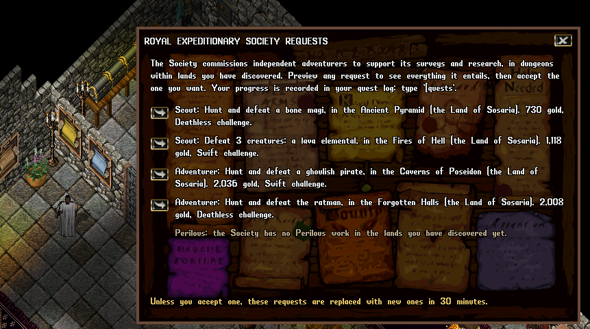

**The sailors' board** ("Seeking Brave Sailors") works the same way. Double-click it to choose from three townsfolk's requests, to collect your pay, or to see your current job.

---

## Travel

- **Mark** works in most locations now, except for dungeons, Skara Brae, Bottles and a few other places.
- Everything else about travel works as you'd expect.

---

## Handy commands

| Command | What it does |
|---|---|
| `[help` | The help window: settings, preferences, commands and your treasury. |
| `[skillbook` | The skills journal. |
| `[quests` | Your quest journal. |
| `[BackpackProgress` | What your next backpack upgrade needs. |
| `[Trade` | Open a trade with the player you target, for gold or items. |
| `[Market` | The marketplace: every item for sale on every player-run vendor in the world, to search and buy from. |
| `[myhunger` | Whether you're well fed from a cooked dish, and for how long. |
| `[TreasuryBalance` | The bank gold available to you. |
| `[TreasuryInvite` | Invite another player's account to your treasury (target one of their characters). |
| `[TreasuryAccept` / `[TreasuryDecline` | Answer a treasury invitation. |
| `[TreasuryLeave` | Leave your treasury. Your gold and items stay in it. |
| `[toolbars` | Your spell bars: set them up, open them, or have them open when you log in. |
| `[music` | The music playlist. Pick the songs you like, including three Frost and Ember tracks, and turn on **Use Playlist** to hear them as you travel. |

---

## Hosting your own server

The server is free to download and run, for yourself or for a group of friends. Get the server package from the Releases page; it starts with a fresh world, with every quest, town and dungeon in place and no characters.

- **Windows:** it needs .NET Framework 4.8, which Windows 10 and 11 already include. Double-click `Start-Server.cmd`.
- **Linux:** it needs Mono (the `mono-complete` package on most distributions). Run `./start-server.sh`.
- **Network:** players connect on TCP port 2593, so open or forward that port to the server.
- **Your owner account:** run the very first start in a visible console window, because the server asks there whether to create the owner account. Answer yes and choose a name and a strong password before anyone logs in. The server also makes a ready-made admin character, Dungeon Master, on that account, and any other character you make on it is an ordinary player. Players' accounts are then created automatically the first time they log in.
- **Pointing a client at your server:** set `"ip"` in the client's `Profiles/Settings/frost-and-ember.json` to your server's address.

The server package's README covers saving, backups and changing the game's settings.

---

## Special thanks

All hail **Djeryv**, **Mangar**, **Xork** and **Tsai**! Credit where credit is due. Frost and Ember exists because of their impressive groundwork, and it's built on Tsai's **Ultima: Memento**.

Check out the great work over at Memento as well: https://discord.gg/eXAAjsRJA

See you in Sosaria.
